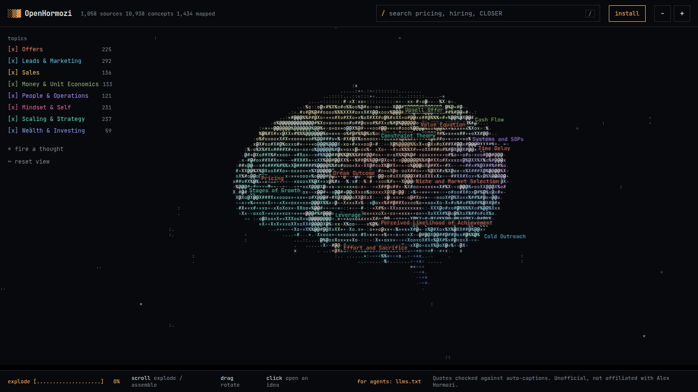
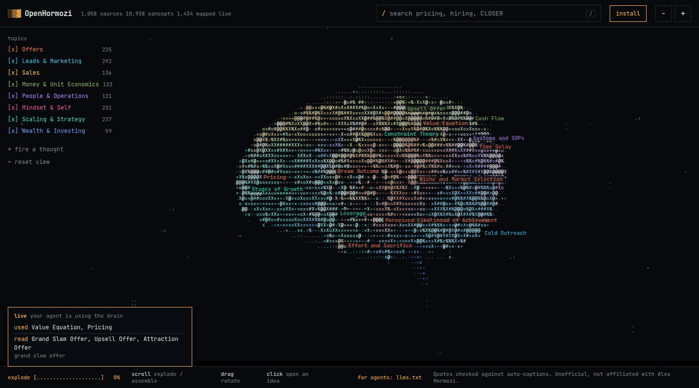
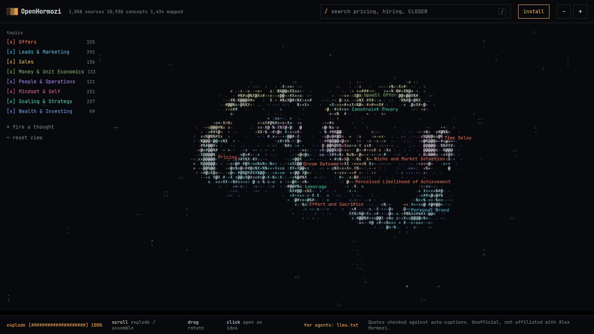

<div align="center">

```
░▒▓ OpenHormozi
```

### Give your AI agent the Hormozi brain.

Everything Alex Hormozi teaches about offers, leads, sales, money and scaling, turned into a wiki your agent can read.<br>
1,434 ideas from 1,058 public videos. Each one has his exact words and a link to the moment in the video.

[](https://www.npmjs.com/package/openhormozi)
[](https://www.npmjs.com/package/openhormozi)
[](https://github.com/zqxuii/OpenHormozi)
[](LICENSE)

[**Explore the brain**](https://www.akshaymenon.qd.je) · [Install](#install) · [Watch it think](#watch-your-agent-think) · [How it works](#how-it-works)



</div>

<br>

You build the agent. You decide what it does, which tools it uses and which apps it connects to. OpenHormozi is the one thing it was missing: a knowledge base it can look things up in and quote from, so its business advice comes from real teaching instead of guesses.

No account. No API key. Free.

## Install

### One paste (any agent)

Works in Claude, Codex, Cursor, OpenClaw, ChatGPT, anything that can read a link. Paste this to your agent. It adds the brain to itself, in the right place for where it runs, and changes nothing else.

```
Read https://raw.githubusercontent.com/zqxuii/OpenHormozi/main/SETUP.md and give yourself the Hormozi brain.
```

### Claude Code plugin

```
/plugin marketplace add zqxuii/OpenHormozi
/plugin install open-hormozi --marketplace zqxuii/OpenHormozi
```

### Terminal

```bash
npx openhormozi brain     # adds the brain to this project's CLAUDE.md or AGENTS.md
npx openhormozi skill     # adds /open-hormozi to Claude Code
npx openhormozi live      # opens your live brain board
```

`brain` adds one section to your agent's instruction file and never replaces what is there. Use `--global` to add it to `~/.claude/CLAUDE.md`.

### Or just point your agent at the wiki

No install. Give it [`brain/index.md`](https://www.akshaymenon.qd.je/brain/index.md).

## What your agent gets

A wiki with one small page per idea, built for agents:

- [`brain/index.md`](https://www.akshaymenon.qd.je/brain/index.md): the topics and the most-covered ideas.
- [`brain/names.txt`](https://www.akshaymenon.qd.je/brain/names.txt): every idea on one line, easy to search.
- `brain/c/<idea>.md`: about 2 KB each. A short summary, his exact words with video links, and related ideas to follow. [Here is Pricing.](https://www.akshaymenon.qd.je/brain/c/pricing.md)

The agent reads two or three pages instead of a whole library, answers for your situation, and quotes him with the link so you can check it.

Prefer data? [`concepts.json`](https://www.akshaymenon.qd.je/concepts.json) has everything, and [`llms.txt`](https://www.akshaymenon.qd.je/llms.txt) is the index for agents. All of it is open to other sites.

## Watch your agent think

```bash
npx openhormozi live
```

It gives you a private link that shows the whole brain. While your agent works, the camera flies to each idea it reads or uses, one after another, with the quotes behind it. A live feed shows what it touched. It works the same on a laptop, a server or a cloud box, because the link lives on the web.

**What gets sent:** only the names of the ideas your agent looked up or used. Never your questions, your business details or anything you type. Keep the link private, since anyone who has it can watch. Stop any time with `npx openhormozi live --off`. Want it fully offline? `npx openhormozi board --local` runs the board on your machine only.

<div align="center">

</div>

Scroll to pull the brain apart into its eight regions, scroll back to put it together, click any idea to read the quotes behind it.

<div align="center">

</div>

## How it works

```
 1,058 videos ──▶ ideas + exact quotes ──▶ checked word for word ──▶ the wiki
                                                                        │
   you ask your agent ──▶ it reads the pages it needs ──▶ answers ◀─────┘
                                  │                     with quotes
                                  └──▶ lights up on your live board
```

1. Every video was read and broken into ideas, with the exact words he used.
2. Each quote was matched word for word against the video's captions. Anything that did not match was thrown out.
3. The ideas are linked into one map of eight areas: Offers, Leads and Marketing, Sales, Money and Unit Economics, People and Operations, Mindset, Scaling and Strategy, Wealth.
4. Your agent reads that wiki instead of guessing from memory.

## FAQ

**Is this Alex Hormozi?** No. This is an unofficial project and he has nothing to do with it. Nothing here is written by him or approved by him. Agents that use the brain are told to teach his frameworks, to quote him only with the exact words and a link, and never to claim to be him.

**Does it run my agent or connect to my tools?** No. That is entirely up to you and your agent. The brain only supplies knowledge.

**Can I trust the numbers?** The quotes come from automatic captions, so a figure can be garbled. Every quote has a timestamp, so check the video before you rely on a number. The short summaries are machine-written paraphrases, and only the text in quotation marks is his.

**Is my live board private?** It is unlisted, and only people with your link can see it. It keeps the last 100 events and is deleted after 7 days without activity.

**Does it cost anything?** No.

**Is this financial or legal advice?** No. Get a qualified professional for anything that matters.

<details>
<summary><b>For builders</b></summary>

<br>

- `site/`: the public website and the wiki (deployed to Cloudflare Pages). `site/agent.md` and `site/skill/SKILL.md` are the source of truth. `SETUP.md` is the one-paste guide.
- `scripts/build-wiki.py`: regenerates `site/brain/` (the wiki) from `site/concepts.json`.
- `bin/openhormozi.js`: the zero-dependency command line tool. `npm run prepack` copies the site files into `assets/`.
- `site/_worker.js`: the relay behind live board links (a Cloudflare Pages worker with a D1 database).
- `.claude-plugin/` and `plugins/open-hormozi/`: the Claude Code marketplace and plugin.
- `search`, `topic` and `use` write to `~/.openhormozi/activity.jsonl`. If you ran `live`, they also send idea names to the relay. `board --local` reads the file directly instead.

### Build your own graph

1. Put your transcripts in `transcripts/<id>.txt`, one line per passage, prefixed with `[m:ss]`. Get them however the platform and the content owner allow.
2. Describe each source in `sources_meta.json` (see `sources_meta.example.json`). The key is the transcript id.
3. Run an LLM extraction per transcript following `EXTRACT_PROMPT.md`, writing `extract/<id>.json`.
4. `python3 verify.py` (writes `verified/`), then `python3 build_graph.py` (writes `graph.json`).
5. `python3 query.py offer`

</details>

## Licence

Code: MIT (see [`LICENSE`](LICENSE)). The MIT license does not cover the quotes in `site/`, which belong to their speakers. Your transcripts and any text generated from them are subject to the rights of their owners.
